<a href="https://github.com/tailucanh">
  
</a>

<p align="center">
  <a href="https://github.com/tailucanh">
    
  </a>
</p>

<p align="center">
  
  <a href="https://github.com/tailucanh?tab=followers"></a>
  
  
</p>

---

## 👽 About me

<table>
<tr>
<td width="58%" valign="top">

- 🏢 Developer at **FPT**, based in **Vietnam**
- 📱 Building mobile apps with **Flutter** and **React Native**
- 🎮 Making games with **Unity** and **C#**
- 🌐 Backend and web with **Node.js**, **Express**, **MongoDB**, **React**
- 🤖 Lately: tools that make **AI coding agents** cheaper and faster
- 🐐 Side project: **[MiēMiē](https://hoc.miemie.io.vn)**, a free web app for learning Chinese
- 💬 Ask me about Flutter, Unity, Node.js or MCP servers
- ⚡ Motto: *"The way you do one thing is the way you do everything."*

</td>
<td width="42%" align="center">
  
</td>
</tr>
</table>

## 🚀 Featured projects

<table>
<tr>
<td>

### [offload-mcp-server](https://github.com/tailucanh/offload-mcp-server)

Let your main coding agent delegate heavy reading to a second agent, and read back only the answer.
Fewer tokens for your main agent, same quality of answers.

<a href="https://github.com/tailucanh/offload-mcp-server"></a>
<a href="https://www.npmjs.com/package/offload-mcp-server"></a>


```bash
npx -y offload-mcp-server setup
```

</td>
</tr>
<tr>
<td>

### [MiēMiē 咩咩](https://hoc.miemie.io.vn): learn Chinese with Miē the goat

A free web app for Vietnamese people learning Chinese on their own, from zero to HSK 6. No install: open it in any browser.

- 🗺️ A 7-stage roadmap that tells you what to study today
- 🎬 76 video lessons with interactive slides, 300+ auto-graded exams (HSK, HSKK, university entrance)
- 🃏 A 14,000+ word dictionary, spaced-repetition flashcards and 16 review games
- 🎨 214 illustrated radicals, 436 idioms with animated pictures, pronunciation practice with scoring

<a href="https://hoc.miemie.io.vn"></a>


<a href="https://hoc.miemie.io.vn"></a>

</td>
</tr>
</table>

<details>
<summary><b>More projects</b></summary>
<br>

| Project | What it is | Stack |
| --- | --- | --- |
| [finder_dating_app](https://github.com/tailucanh/finder_dating_app) | Dating app |  |
| [monumental_habit_app](https://github.com/tailucanh/monumental_habit_app) | Habit tracker |  |
| [flutter_draw_app](https://github.com/tailucanh/flutter_draw_app) | Drawing app |  |
| [unity_draw_app](https://github.com/tailucanh/unity_draw_app) | Drawing app |  |
| [tiktok-live-template](https://github.com/tailucanh/tiktok-live-template) | TikTok LIVE template |  |
| [blockchain-community-based-voting-dapp](https://github.com/tailucanh/blockchain-community-based-voting-dapp) | Community voting dApp |  |

</details>

## 🛠 Tech stack

<table align="center">
<tr>
  <td align="center" width="130"><b>📱 Mobile</b></td>
  <td></td>
</tr>
<tr>
  <td align="center"><b>🎮 Game</b></td>
  <td></td>
</tr>
<tr>
  <td align="center"><b>⚙️ Backend</b></td>
  <td></td>
</tr>
<tr>
  <td align="center"><b>🌐 Frontend</b></td>
  <td></td>
</tr>
<tr>
  <td align="center"><b>🧰 Tools</b></td>
  <td></td>
</tr>
</table>

## 🔥 GitHub stats

<p align="center">
  
  
</p>

<p align="center">
  
</p>

## 🐍 My contributions

<p align="center">
  <picture>
    <source media="(prefers-color-scheme: dark)" srcset="https://raw.githubusercontent.com/tailucanh/tailucanh/output/github-contribution-grid-snake-dark.svg" />
    <source media="(prefers-color-scheme: light)" srcset="https://raw.githubusercontent.com/tailucanh/tailucanh/output/github-contribution-grid-snake.svg" />
    
  </picture>
</p>

## 🛸 Where to find me

<p align="center">
  <a href="https://tailucanh.github.io/myprofile/"></a>
  <a href="https://www.linkedin.com/in/lucanhtai1504/"></a>
  <a href="https://www.facebook.com/lucanhtai1504"></a>
  <a href="https://www.tiktok.com/@tai_it_1504"></a>
  <a href="https://www.instagram.com/tai_it__1504/"></a>
  <a href="https://www.youtube.com/channel/UCy7sxcFG-eGIzcjbn3aYHdQ"></a>
  <a href="mailto:lucanhtai1504@gmail.com"></a>
</p>

<p align="center">
  
</p>


